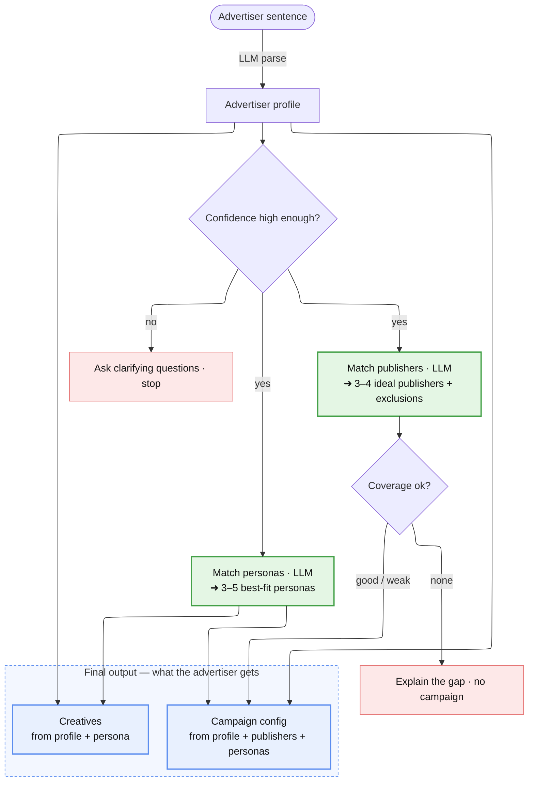

# Disco Campaign AI

An advertiser types one or two sentences about their business; the system returns a
**draft campaign**: ranked publishers (with reasons and exclusions), persona-tuned
ad creatives (up to five, one per strong-fit persona, each with its reasoning), and a
structured campaign config a human can review, edit, and launch.

It handles messy input ("idk just try it" → asks instead of guessing), shows its work
(every pick has a reason), is honest when the catalog has no good fit (a B2B dental
tool returns *no match*, not a forced one), and never goes fully dark — every stage has
a fallback, so a single LLM outage degrades the output instead of crashing it.

## Run it

```bash
cp .env.example .env          # paste a free Groq key (console.groq.com/keys)
pip install -r requirements.txt
pytest -q                     # 134 tests, no API key needed (offline, deterministic path)
streamlit run app.py          # open http://localhost:8501
```

Docker: `docker compose up` (reads `.env`, serves on `:8501`).

- `GROQ_API_KEY` (required) — the primary LLM for parsing, matching, and creatives.
- `GEMINI_API_KEY` (optional) — a **cross-provider fallback**: if Groq fails, the same
  calls retry on Gemini before the offline fallbacks kick in.

The tests need no key: they drive the deterministic path and stub the LLM, so CI stays
free and fast.

## How it works



Each step's input → output (LLM steps are marked; every LLM step has an offline fallback — see the fallback table below):

1. **Parse** · *LLM* — the raw sentence → an 18-field `AdvertiserProfile`: product category, subcategories, price point + positioning, target audience / gender / age / geography, USPs, values, brand tone, brand name, business model, expected AOV, seasonality, plus the gate fields (confidence, missing info, clarifying questions).
2. **Confidence gate** — below 0.45 the profile is too thin, so the system asks clarifying questions and stops; no invented campaign.
3. **Match publishers** · *LLM* — profile + all **20** publisher briefs (category, AOV, audience, income tier, reach) → every publisher scored 0–100 with a reason and an `excluded` flag.
4. **Match personas** · *LLM* — profile + all **10** persona briefs (affinities, price-sensitivity, typical AOV, messaging prefs, disinterests) → every persona scored with a reason; the strongest (up to 5) that clear a floor of 30 are selected. Publisher and persona matching run — and fall back — independently.
5. **Coverage check** (on publishers) — good / weak / none. On *none* (nothing clears the exclusion bar), the system explains the gap and stops: no creatives, no budget.
6. **Creatives** · *LLM*, one per selected persona — profile + persona → headline, body, messaging angle, reasoning; a claim-guard removes any claim the advertiser never made.
7. **Campaign config** · *deterministic, no LLM* — assembled from the profile + recommended publishers + selected personas (creatives are a separate output, not part of it). AOV = stated price → else mean publisher AOV → else mean persona AOV; CPA = 30% of AOV; CVR = category benchmark (1.2% if AOV ≥ $500); CPC = CPA × CVR; daily budget = 15 × CPA; total = 30-day flight. Plus the budget split across publishers by score, targeting, a deliverability forecast, a measurement block, and a `feedback` block (predicted vs. actual) for future training.

**The core design decision — LLM for language *and* for the match judgment.** Reading
fuzzy input and writing copy are language tasks, so they use an LLM. Matching is also,
at its heart, a *judgment* about audience fit — and the thing that makes it hard
(e.g. "$1,200 handbags → the highest-AOV, affluent-audience publisher, not the budget
one") is exactly the kind of multi-field reasoning an LLM does well and a keyword/weight
system does not. So the matcher sends each publisher/persona to the LLM with the real
fields and gets back a score + a reason that cites those fields. The campaign config
stays deterministic (testable arithmetic); every knob lives in `src/config.py`.

## The matcher: LLM primary, deterministic fallback

Both matchers sit behind one `Matcher` interface (`src/matching.py`, swappable via
`get_matcher(name)`) and return the same Pydantic objects, so nothing downstream cares
which one ran:

| Matcher | What it is | Role |
|---|---|---|
| **LLM (Groq)** | scores every publisher/persona 0–100 with a reason, reading the real fields | **shipped / primary** — correct top picks, honest "no match," the only approach that reads AOV/income/gender to get luxury right |
| **Deterministic** | weighted field/lexical scoring, no API (`src/fallback_matchers.py`) | **offline fallback** — clean, free, fully testable; used automatically when the LLM is unavailable, and by the offline test suite |

The LLM wins on the thing the brief actually tests — *matching well, with visible
reasoning* — so it ships as the primary. The deterministic matcher isn't a throwaway: it
keeps the whole pipeline working (and the 134 tests running) with no API key at all.

To keep the LLM disciplined: a rubric in the prompt (direct category/affinity → 85–100;
a shared value/demographic alone → the weak 30–59 band) stops it clustering everything
high; a post-filter
(`LLM_RECOMMEND_GAP`) drops anything far below the top pick; and each call is fed only
the fields that mirror its target (publishers get audience/economics, personas get
affinity/messaging/price).

**Where the fallback's weights come from.** The deterministic matcher's weights
(`PUBLISHER_WEIGHTS`, `PERSONA_WEIGHTS` in `config.py`) are **hand-set priors, not learned
parameters** — at cold-start there's no conversion data to fit them to, which is the whole
reason the LLM is primary. What's justified is the *ordering*, from ad-targeting first
principles: **category/affinity dominates** (if the audience doesn't shop the category,
nothing else matters), then finer relevance / message fit, then audience and price, with
**AOV weakest** (everyday products are bought regardless of basket size). Equal weights
were rejected — they'd imply AOV matters as much as category, which it doesn't. Each weight
and cutoff is documented inline in `config.py` with its rationale. This is deliberately
different from the **economic constants** (CPA/CVR/CTR), which *are* grounded in published
benchmarks (Oberlo/Statista, cited in `config.py`) because conversion rates are a knowable
industry prior; matcher weights aren't knowable without your own data, so they stay honest
heuristics and would be learned from campaign outcomes in production.

## The campaign economics (Step 4)

The config isn't decoration — the numbers are derived, and every constant is sourced in
`src/config.py`:

- **AOV** — the real average order value, resolved in priority order: the advertiser's
  stated price → the mean AOV of the recommended publishers → the selected personas'
  typical AOV. Never a guessed midpoint.
- **CPA = 0.30 × AOV** — target cost per acquisition as a fixed fraction of order value.
- **CVR by category** — conversion rate comes from real DTC benchmarks per category
  (`CVR_BY_CATEGORY`: groceries/beverages ~4.5%, beauty ~4%, wellness ~3%, apparel
  ~2.8%, pet ~2.5%, home ~1.4%), with a high-ticket exception (AOV ≥ $500 → ~1.2%).
  A $60 dog-food order and a $1,200 handbag do **not** convert at the same rate.
- **CPC = CPA × CVR**, **daily budget = 15 × CPA** (≈15 conversions/day), **total budget
  = daily × 30-day flight**.
- **Forecast** — expected clicks, impressions, and ROAS, cross-checked against the
  publishers' available monthly impressions so the plan is physically deliverable.

## Honest when the catalog doesn't fit

A coverage check reads the best publisher score and labels the result **good / weak /
none**. On *weak*, the campaign still ships but is flagged. On *none* (a B2B dental SaaS
against a consumer-DTC catalog), the pipeline refuses to fabricate publishers, creatives,
or a budget — it returns the honest gap and an LLM note describing the *ideal* publisher
that would fit, even though it isn't in the catalog. A forced match is worse than no
match.

Coverage is judged on **publisher** fit, because a creative is an ad placed *on* a
publisher — with no viable publisher there is nowhere to run the copy, so on *none* the
creative and budget stages are skipped entirely (the personas are still shown, with honest
low scores, for transparency). And even on a good match, copy is written only for the
*selected* personas (up to 5), never for the low-scoring ones you aren't targeting.

## Never goes dark: a fallback at every stage

Every LLM-dependent stage returns a valid Pydantic object even when the LLM is down, and
the fallbacks are **granular** — a publisher-matching outage doesn't throw away the
persona LLM result:

| Stage | Primary | Fallback |
|---|---|---|
| Parse | LLM extracts the 18-field profile | keyword extraction from the raw text |
| Match (publisher) | LLM scores + reasons | deterministic matcher (independent of persona) |
| Match (persona) | LLM scores + reasons | deterministic matcher (independent of publisher) |
| Coverage note | LLM explains the gap | static "no strong fit" note |
| Creative | LLM writes claim-guarded copy | template built from the advertiser's own USP/values |
| Campaign | already deterministic | — |

Each degradation is recorded in `degraded_notes` so the UI can tell the user exactly
what ran in fallback mode. `scripts/demo_fallbacks.py` proves this across six scenarios
(every stage down, in turn) without touching a real API.

## Keeping the copy honest (claim-guard)

Generated creatives can only make claims the advertiser actually gave us. A guard
(`BANNED_CLAIM_PHRASES`) catches fabricated "sustainable / transparent supply chain"
style claims and cheap positioning tells ("priced thoughtfully"); on a hit the creative
is regenerated up to twice, then the body is stripped and the headline replaced with a
grounded USP. Persona *preferences* inform the angle; they never become invented facts.

## Does this scale? (the honest answer)

Direct LLM calls are the right choice for a **cold-start prototype** (20 publishers, no
historical data) and the **wrong** choice at a catalog of millions — one call that scores
the whole catalog is a latency/cost bottleneck. The migration path is a documented
*plan*, not shipped code:

| Stage | Approach | When |
|---|---|---|
| **Now** | Direct LLM scoring | cold-start, tiny catalog, no training data |
| **Scale** | Embedding recall → LLM rerank | embed the catalog once into a vector DB (ANN is sub-linear), retrieve the top-K cheaply, LLM reranks only those K — LLM quality at a fixed cost per request, independent of catalog size |
| **Mature** | Two-tower + GBDT reranker | once there is **conversion data** to train on; the LLM's scores/reasons bootstrap the first labels |

Key point: a two-tower/GBDT model is "highest accuracy" **only with conversion labels**
— which don't exist on day one. With no data, the LLM's zero-shot reasoning is the
highest-accuracy option *and* it generates the signal to bootstrap toward a trained model
later. So: **LLM now → recall + rerank at scale → learned model once data exists.**

The hook for that last step is already in the config. Each campaign carries a
`measurement` block (conversion event, 7-day attribution window, KPI targets) and a
`feedback` block that stores **predicted vs. actual** performance — i.e. the first
training labels for the learned ranker. The system is built to be told it was wrong.

## What I'd do next

- **Close the feedback loop.** Capture accept/reject + the `feedback` block's actuals,
  use the LLM's scores as the first labels, and train the two-tower reranker above.
- **Vector DB + ANN** behind a recall stage (the loader is already an abstraction seam).
- **Cache + batch** the LLM calls, and run publisher and persona matching concurrently.

## What I intentionally cut

- **No trained CTR/CVR model** — there's no historical data to train on, so it would be
  theater. The LLM is the honest cold-start fit; the trained model is the documented
  endgame, and the `feedback` block is the seam that gets us there.
- **No vector DB / multi-agent / auth** — none earn their complexity at prototype scale;
  they're the scaling plan above, not day-one work.
- **One creative per persona**, not A/B variants, to stay cleanly inside the 3–5 the
  brief asks for.

## Layout

```
app.py                     Streamlit UI
src/
  pipeline.py              orchestrator: description → profile → match → creative → config
  advertiser_parser.py     Step 1: LLM parse (+ keyword fallback)
  matching.py              Step 2: one Matcher interface holding both strategies —
                           LLMMatcher (primary, runs) + DeterministicMatcher (fallback)
  fallback_matchers.py     deterministic FALLBACK scoring (publisher + persona)
  creative_generator.py    Step 3: LLM creatives (+ template fallback, claim-guard)
  campaign_builder.py      Step 4: economics, forecast, measurement, feedback
  derivation.py            Step 1.5: positioning → AOV band / seasonality
  models.py                all Pydantic models
  config.py                every tunable constant, with sources
  taxonomy.py              category/geo vocabulary derived from the catalog
  llm.py                   Groq call + Gemini cross-provider fallback + retries
  data_loader.py           publishers.json / personas.json / example_advertisers
prompts/                   the LLM prompts (extraction, matching, creative)
tests/                     134 offline tests
scripts/                   demo_fallbacks.py — the 6-scenario fallback demo
docs/                      known_limitations.md — edge cases + the path to production
```
