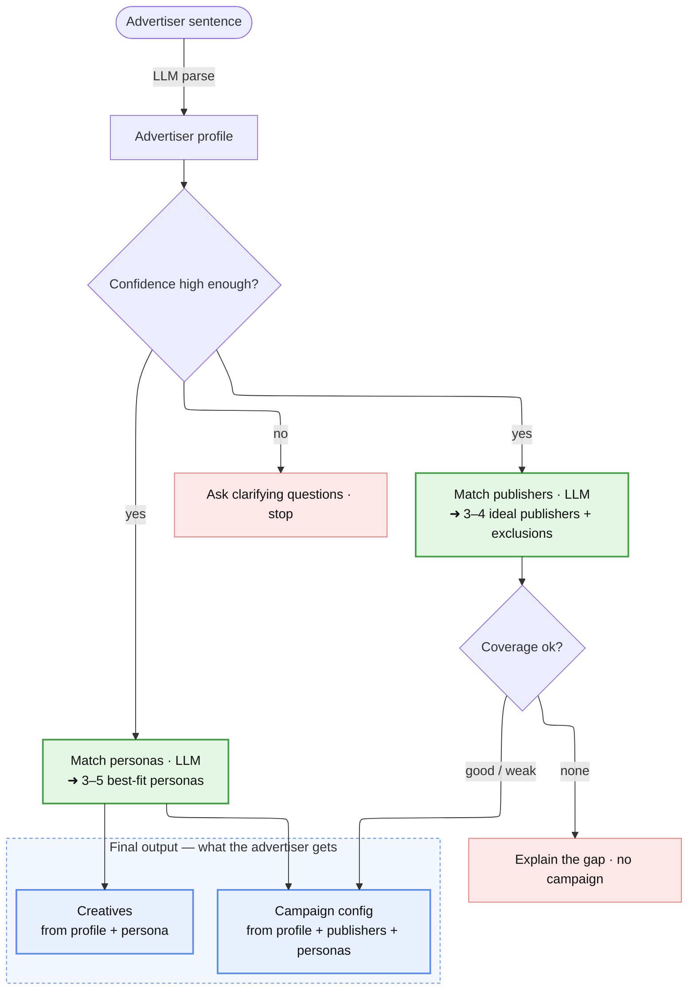

# Disco Campaign AI

An advertiser describes their business in a sentence or two. The product hands back a
**ready-to-review campaign**:

1. **Ranked publishers** — where to advertise, each with a reason, plus the ones we ruled
   out and why.
2. **Up to 5 ad creatives** — one per shopper persona worth targeting, written in that
   persona's voice, with the thinking shown.
3. **A campaign config** — targeting, budget split, bid strategy, and a forecast a human
   can review and launch.

It behaves like a careful strategist, not a demo: it **asks** instead of guessing when the
input is vague, says **"no good fit"** instead of forcing a match when the catalog doesn't
suit the advertiser, and keeps working even if the AI is briefly down.

**Live demo:** https://disco-campaign-ai.streamlit.app

## Run it

```bash
cp .env.example .env          # paste a free Groq key (console.groq.com/keys)
pip install -r requirements.txt
pytest -q                     # 132 tests, no API key needed
streamlit run app.py          # open http://localhost:8501
```

- `GROQ_API_KEY` (required) — the AI behind understanding, matching, and creatives.
- `GEMINI_API_KEY` (optional) — a backup AI: if Groq fails, the same calls retry on Gemini.

## How it works



Five decisions. Each reads specific inputs and produces a specific output:

**1 · Understand the advertiser.**
*In:* the raw sentence. *Out:* an **18-field profile** — product category & subcategories,
price point & positioning, target audience (age / gender / geography), USPs, values, brand
tone, business model, and an expected order value.
If the sentence is too thin to fill these confidently, the product **stops and asks**
rather than inventing a campaign. *("idk just try it" → asks what you actually sell.)*

**2 · Pick the publishers.**
*In:* the profile + all 20 publishers (audience, income tier, average order value, reach).
*Out:* every publisher scored 0–100 with a one-line reason, poor fits marked **excluded**.
The call is audience fit — a $1,200 handbag brand should land on the affluent,
high-order-value publisher, not the budget one.

**3 · Pick the personas.**
*In:* the profile + all 10 personas (category affinities, price sensitivity, typical spend,
what they dislike). *Out:* each persona scored with a reason; the strongest (up to 5) are
selected. A persona that's *put off* by the advertiser's positioning is pushed down — we
don't target people the product would turn off.

**4 · Write the creatives.**
*In:* the profile + each selected persona. *Out:* one headline + body per persona, in that
persona's language, with the reasoning shown. A guard strips any claim the advertiser never
made, so the copy never oversells.

**5 · Build the campaign config.**
*In:* the profile + recommended publishers + selected personas. *Out:* targeting, a budget
split weighted by fit, a bid strategy, and a deliverability forecast — every number derived
(see *The numbers*), none guessed.

## The matching logic — why it picks what it picks

Matching is a judgment, not keyword overlap, so this is where the product uses the most
business sense. It weighs the fields in a deliberate order:

- **Category / affinity first.** If the audience doesn't shop the category, nothing else
  matters — so this dominates the score.
- **Then message & audience fit** — does the publisher's audience and the persona's taste
  line up with the brand's positioning and values.
- **Then price alignment** — a premium brand belongs with low-price-sensitivity shoppers
  and high-order-value publishers; a value brand with the opposite.
- **Order value counts least** — people buy everyday products regardless of basket size, so
  AOV nudges the ranking rather than driving it.

These priorities are deliberate **priors**, not weights learned from data (there's no
campaign history yet) — which is exactly why the AI, reading all the fields together, makes
the call and shows its reason, so you can trust it or override it.

## The numbers — grounded, not guessed

Every figure traces to a real input or a cited benchmark:

- **Order value (AOV)** — the advertiser's stated price if given, else the average of the
  recommended publishers, else the personas' typical spend. Never a made-up midpoint.
- **Cost per acquisition = 30% of order value** — the campaign stays profitable spending up
  to a third of a sale to win it.
- **Conversion rate by category** — real DTC benchmarks: groceries/beverages ~4.5%, beauty
  ~4%, wellness ~3%, apparel ~2.8%, pet ~2.5%, home ~1.4%, and high-ticket (≥ $500) ~1.2%.
  A $60 dog-food order and a $1,200 handbag don't convert alike.
- **Budget, clicks, impressions, ROAS** follow from those, and the forecast is checked
  against the publishers' real available inventory so the plan is physically deliverable.

## Honest when nothing fits

The product grades its own coverage. A consumer-DTC catalog has no home for a B2B dental
tool — so instead of fabricating publishers and a budget, it returns **no campaign** and
names the kind of publisher that *would* fit. A forced match wastes the advertiser's money
and their trust, so a forced match is worse than no match.

*Example:* "handmade dog collars" → strong pet-publisher matches, full campaign.
"enterprise tax-filing software" → no consumer publisher fits, so the product says so.

## Always-on (the fallback)

Each AI step has a simple rule-based backup, so a single outage degrades the output instead
of crashing it.
- **Benefit:** the product always returns a valid, usable campaign — and the full test suite
  runs with no API key at all.
- **Trade-off:** in backup mode the matching is rule-based, so blunter than the AI's
  reasoning. That's why the AI is the default and the backup only catches it when it falls.

## What's genuinely hard here (and what isn't)

The easy part is the plumbing — the interface, loading the catalog, the campaign arithmetic.
Write it once and it stays correct. The hard part, where the real judgment lives, is:

- **Ranking with no history.** With no past clicks to learn from, "good match" has to come
  from reasoning — and knowing when *not* to match (excluding most of the catalog, or
  returning no campaign) is harder, and the piece most prototypes skip.
- **Copy that fits one persona and invents nothing.** Generic copy is easy; copy written
  *for* the Wellness Optimizer that stays true to what the advertiser said is the hard part.
- **Numbers you can defend.** Any tool will emit a budget; making every figure trace to a
  benchmark or a stated input is the difference between a demo and something real.

## What I'd do next

- **Close the feedback loop** — capture what the advertiser accepts vs. rejects and the
  actual results, and use them to learn the ranking the system now reasons out.
- **Scale the matching** — at a catalog of millions, retrieve a shortlist cheaply first,
  then let the AI rank only those; add caching and run the matches in parallel.

## What I intentionally cut

- **No trained performance model** — there's no historical data to train on, so it would be
  theater. The AI is the honest cold-start fit; the feedback loop above is how it earns one.
- **No vector search / multi-agent / logins** — none earn their complexity at this size.
- **One creative per persona**, not A/B variants, to stay cleanly inside the 3–5 the brief
  asks for.
- **Subcategory-level publisher matching** — a grocery-*delivery* advertiser didn't surface
  the grocery publisher because matching keys on the top-level category. A subcategory boost
  fixed that one case but shifted unrelated rankings, so I kept the stable version and left
  this as a known edge case.

## Layout

```
app.py          the interface
src/            pipeline, matching, creative, campaign builder, models, config, AI client
prompts/        the AI prompts (understanding, matching, creative)
data/           publishers.json · shopper_personas.json · example_advertisers.txt
tests/          132 offline tests (no API key needed)
docs/           known_limitations.md — edge cases + the path to production
```
